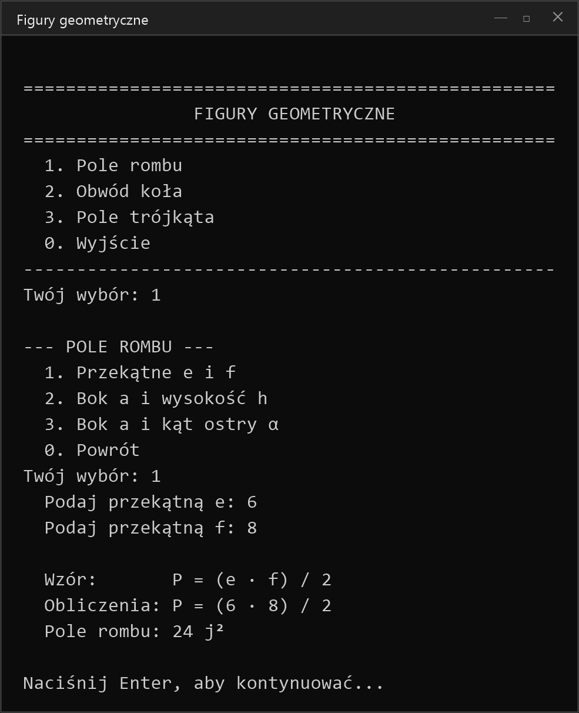
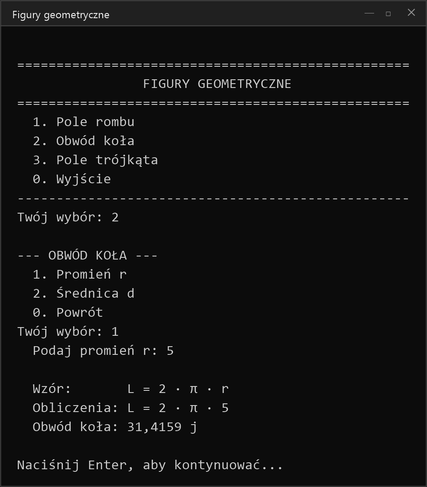
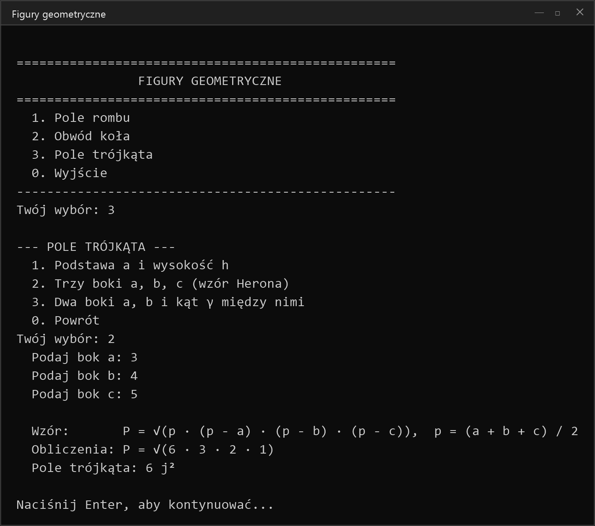

# Figury geometryczne

Aplikacja konsolowa w języku **C#** (platforma .NET 10), która oblicza:

* **pole rombu**,
* **obwód koła**,
* **pole trójkąta**.

Program prowadzi użytkownika przez proste menu tekstowe, pokazuje użyty wzór,
podstawienie danych oraz wynik (w polskiej notacji z przecinkiem dziesiętnym).

## Obsługiwane warianty obliczeń

| Figura      | Metoda              | Wzór                          |
|-------------|---------------------|-------------------------------|
| Romb        | przekątne `e`, `f`  | `P = (e · f) / 2`             |
| Romb        | bok `a`, wysokość `h` | `P = a · h`                 |
| Romb        | bok `a`, kąt `α`    | `P = a² · sin(α)`             |
| Koło        | promień `r`         | `L = 2 · π · r`               |
| Koło        | średnica `d`        | `L = π · d`                   |
| Trójkąt     | podstawa `a`, wysokość `h` | `P = (a · h) / 2`     |
| Trójkąt     | boki `a`, `b`, `c`  | wzór Herona                   |
| Trójkąt     | boki `a`, `b`, kąt `γ` | `P = (a · b · sin(γ)) / 2` |

Program sprawdza poprawność danych: odrzuca wartości niedodatnie, kąty spoza
przedziału `(0°, 180°)` oraz takie długości boków, z których nie można zbudować
trójkąta. Zarówno przecinek, jak i kropka są akceptowane jako separator
dziesiętny.

## Wymagania

* [.NET SDK 10.0](https://dotnet.microsoft.com/download) lub nowszy.

## Uruchomienie

```bash
dotnet run --project src/Figury
```

lub po zbudowaniu wersji Release:

```bash
dotnet build -c Release
src/Figury/bin/Release/net10.0/Figury.exe
```

## Struktura projektu

```
Figury.slnx
src/Figury/
├── Figury.csproj
├── Program.cs          – menu i prezentacja wyników
├── Input.cs            – wczytywanie i walidacja danych z konsoli
└── Geometry/
    ├── Rhombus.cs      – obliczenia dla rombu
    ├── Circle.cs       – obliczenia dla koła
    └── Triangle.cs     – obliczenia dla trójkąta
screenshots/            – zrzuty ekranu z działania programu
```

## Zrzuty ekranu

Pole rombu (przekątne `e = 6`, `f = 8`):



Obwód koła (promień `r = 5`):



Pole trójkąta (boki `3`, `4`, `5` – wzór Herona):


